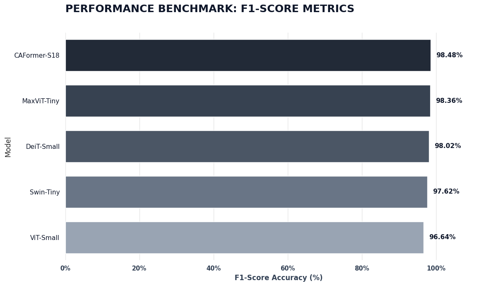
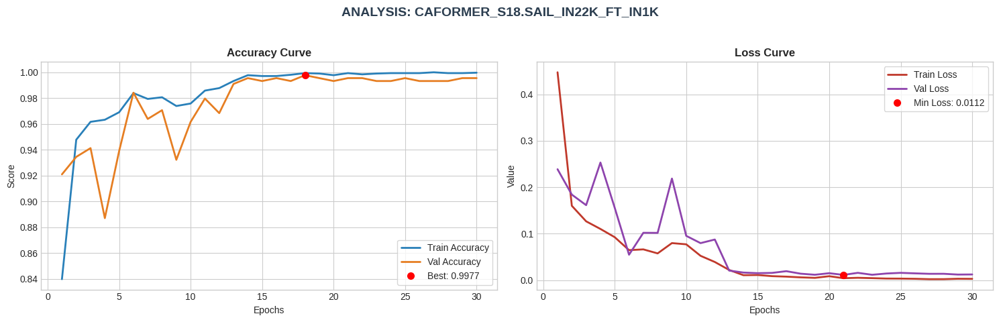
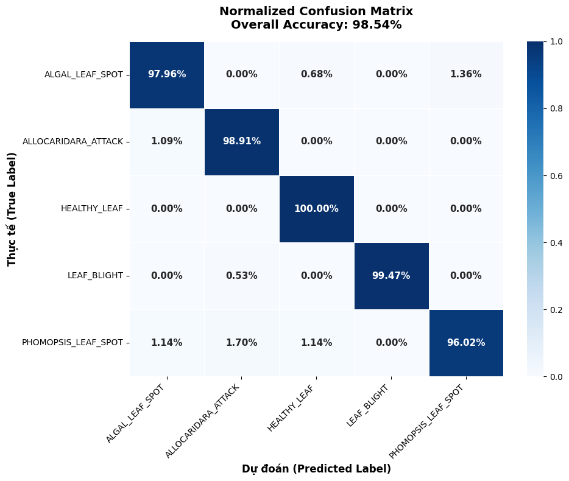
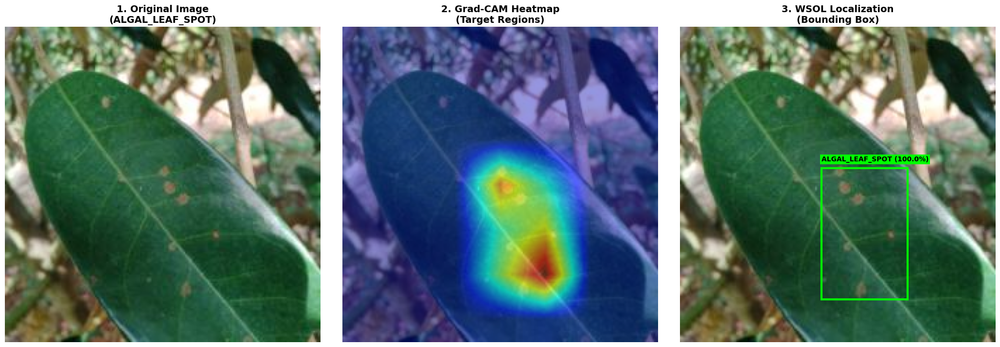
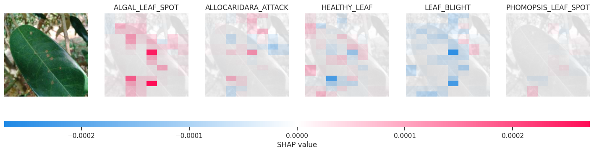
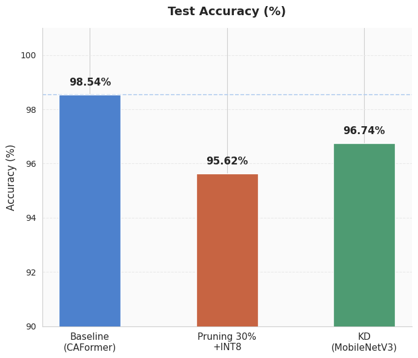
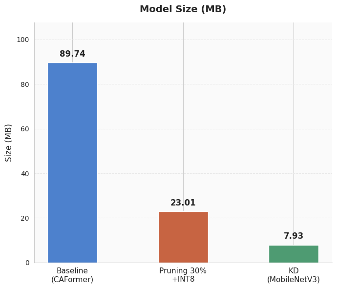
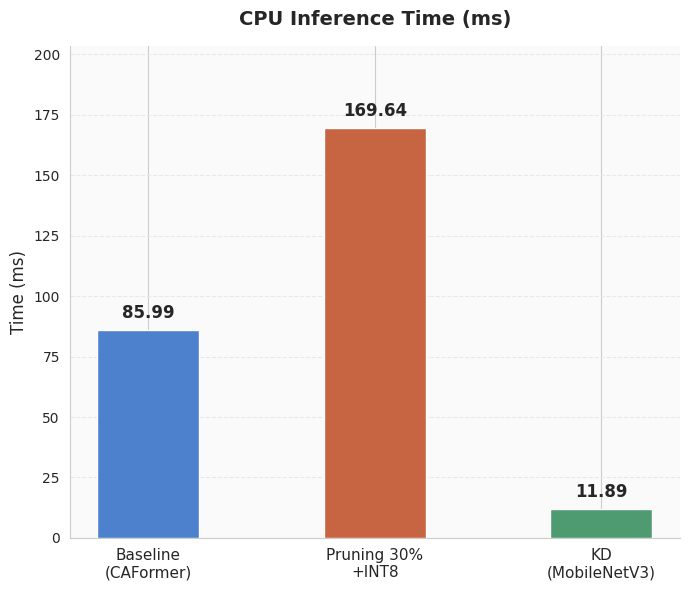
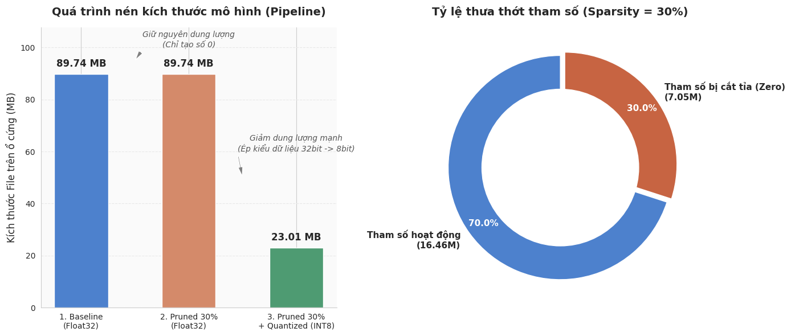

# 🌿 Chẩn đoán bệnh lá sầu riêng bằng học sâu

Nhận diện 5 nhóm bệnh trên lá sầu riêng chỉ từ một tấm ảnh, kèm bản đồ vùng bệnh
và trợ lý AI giải thích. Dự án đi trọn từ huấn luyện mô hình đến ứng dụng web chạy thật.

| | | | |
|---|---|---|---|
| **Độ chính xác** | 98.54% | **Macro F1** | 0.9848 |
| **Mô hình** | CAFormer-S18 | **Bản gọn** | MobileNetV3, 2.05M |
| **Giải thích** | Grad-CAM + WSOL | **Kiểm thử** | 115 test |

> 📓 Toàn bộ huấn luyện và chưng cất chạy trên Kaggle. Biểu đồ trong README là ảnh
> thật xuất từ notebook đó: **[→ Xem trên Kaggle](https://www.kaggle.com/code/lmminhtrn/training-dldd-24april26)**

## Quy trình

| Bước | Làm gì | Kết quả |
|---|---|---|
| **1. Dữ liệu** | 4.437 ảnh, 5 nhóm bệnh | chia 70/10/20 |
| **2. Huấn luyện** | so sánh 5 kiến trúc ViT | CAFormer-S18, 98.54% |
| **3. Giải thích** | Grad-CAM + WSOL | khoanh vùng bệnh |
| **4. Chưng cất** | Progressive KD | MobileNetV3, nhẹ hơn 11,5× |
| **5. Ứng dụng** | FastAPI + trợ lý AI | web chẩn đoán |
| **6. Triển khai** | Docker | dùng bản gọn |

---

## 1. Dữ liệu

Ảnh lá sầu riêng chụp tại vườn ở Việt Nam, chia sẵn theo tỉ lệ 70/10/20.

| | Huấn luyện | Kiểm định | Kiểm tra | Tổng |
|---|---|---|---|---|
| Số ảnh | 3.104 | 443 | 890 | **4.437** |

| Lớp | Tác nhân | Loại |
|---|---|---|
| `ALGAL_LEAF_SPOT` | *Cephaleuros virescens* | Tảo ký sinh |
| `ALLOCARIDARA_ATTACK` | *Allocaridara malayensis* | Côn trùng |
| `HEALTHY_LEAF` | — | Lá khoẻ |
| `LEAF_BLIGHT` | *Rhizoctonia solani* | Nấm |
| `PHOMOPSIS_LEAF_SPOT` | *Phomopsis durionis* | Nấm |

---

## 2. Huấn luyện và chọn mô hình

Transfer learning trên 5 backbone đã tiền huấn luyện ImageNet (qua `timm`), dùng
chung một đầu phân loại để so sánh công bằng. Mỗi mô hình 30 epoch.

| Mô hình | Tham số (M) | Độ chính xác | Macro F1 | Thời gian train |
|---|---|---|---|---|
| **CAFormer-S18** | 23.5 | **98.54%** | **0.9848** | 70,4 phút |
| MaxViT-Tiny | 30.7 | 98.43% | 0.9836 | 39,8 phút |
| DeiT-Small | 21.9 | 98.09% | 0.9802 | 18,8 phút |
| Swin-Tiny | 27.9 | 97.75% | 0.9762 | 23,9 phút |
| ViT-Small | 21.9 | 96.74% | 0.9664 | 18,5 phút |



Chọn **CAFormer-S18** vì chính xác nhất.



Ma trận nhầm lẫn trên 890 ảnh test:



Lá khoẻ nhận đúng 100%. Lớp khó nhất là `PHOMOPSIS_LEAF_SPOT` (recall 96%), hay bị
nhầm với các bệnh đốm khác vì cùng biểu hiện đốm nhỏ rải rác.

---

## 3. Giải thích mô hình (XAI)

Mô hình không chỉ báo nhãn, mà còn chỉ ra vùng nó dựa vào để kết luận.

- **Grad-CAM** — bản đồ nhiệt vùng ảnh hưởng mạnh nhất tới dự đoán.
- **WSOL** — khung bao quanh vùng bệnh, suy ra từ bản đồ nhiệt. Mô hình chỉ học
  nhãn mức ảnh, chưa bao giờ được dạy vị trí bệnh.



**SHAP** phân rã đóng góp của từng vùng ảnh vào điểm số mỗi lớp (đỏ: ủng hộ, xanh: phản đối).



Grad-CAM và WSOL đều tự viết bằng NumPy/PyTorch thuần, đã đối chiếu khớp với
`pytorch-grad-cam` và OpenCV. Chi tiết trong [TECHNICAL.md](docs/TECHNICAL.md).

---

## 4. Chưng cất mô hình

CAFormer-S18 chính xác nhất nhưng nặng (23,5M tham số, ~220 ms/ảnh trên CPU). Dùng
**Progressive Knowledge Distillation**: CAFormer làm giáo viên dạy lại cho mô hình
nhỏ. Trọng số giữa "học nhãn thật" và "học giáo viên" đổi dần qua 3 pha:

| Pha | Epoch | T | α | Ý nghĩa |
|---|---|---|---|---|
| 1. Khởi động | 1–5 | 1.0 | 0.99 | gần như chỉ học nhãn thật |
| 2. Chuyển tiếp | 6–20 | 2.0 | 0.60 | bắt đầu học từ giáo viên |
| 3. Chưng cất | 21–30 | 3.0 | 0.40 | nhiệt độ cao làm lộ *dark knowledge* |


### Kết quả

So ba hướng nén: giữ nguyên CAFormer, cắt tỉa 30% + lượng tử hoá INT8, và chưng cất
sang MobileNetV3. Chưng cất cho mô hình nhỏ nhất và nhanh nhất.

<table>
<tr>
<td width="33%"></td>
<td width="33%"></td>
<td width="33%"></td>
</tr>
<tr>
<td align="center"><i>Độ chính xác (%)</i></td>
<td align="center"><i>Dung lượng (MB)</i></td>
<td align="center"><i>Tốc độ CPU (ms)</i></td>
</tr>
</table>



So giáo viên và học trò trên cùng một CPU trong ứng dụng web:

| | CAFormer-S18 | MobileNetV3-Small | |
|---|---|---|---|
| Tham số | 23.50M | 2.05M | nhẹ hơn **11,5×** |
| Tệp trọng số | 90 MB | 8 MB | |
| Thời gian/ảnh | 219 ms | **49 ms** | nhanh hơn **4,5×** |
| Độ chính xác | 98.54% | 96.74% | kém **1,8 điểm %** |

Đổi lại 1,8 điểm phần trăm là thêm 16 lỗi trên 890 ảnh test, tức khoảng 1 lỗi mỗi 56 ảnh.

---

## 5. Ứng dụng web

FastAPI + PyTorch phía sau, giao diện HTML/CSS/JS thuần phía trước (không framework,
không CDN, font tự host).


Chẩn đoán xong, trợ lý AI (LLM qua OpenRouter) giải thích bằng lời dễ hiểu và trả
lời các câu hỏi tiếp theo.


| Lớp | Thành phần |
|---|---|
| Mô hình | PyTorch, timm |
| Backend | FastAPI, Uvicorn, Pydantic v2 |
| XAI | Grad-CAM + WSOL tự viết (NumPy thuần) |
| Trợ lý AI | OpenRouter, truyền theo luồng SSE |
| Frontend | HTML/CSS/JS thuần, font Be Vietnam Pro |
| Kiểm thử | pytest (115 test), ruff |

---

## 6. Triển khai

Bản triển khai dùng mô hình chưng cất (nhẹ RAM, hợp hosting rẻ). Đổi mô hình chỉ
cần sửa `.env`:

```bash
BACKBONE_NAME=mobilenetv3_small_100
MODEL_PATH=models/mobilenetv3_small_kd_best.pth
METRICS_PREFIX=mobilenetv3_small_kd
```

Chạy bằng Docker (image chứa sẵn cả hai trọng số):

```bash
docker compose up --build                    # http://127.0.0.1:8000
HOST_PORT=8081 docker compose up --build     # nếu cổng 8000 bận
```

Cấu hình chạy sau nginx + TLS nằm ở `deploy/docker-compose.prod.yml`. Chi tiết vận
hành, năng lực phục vụ, giới hạn tần suất: [TECHNICAL.md](docs/TECHNICAL.md).

---

## Chạy thử

```bash
make setup     # tạo .venv, cài phụ thuộc
make dev       # http://127.0.0.1:8000
```

Thư mục [`samples/`](samples/) có 10 ảnh lấy từ tập test, tên tệp chính là đáp án đúng.

Trợ lý AI là tuỳ chọn: không có `OPENROUTER_API_KEY` thì nút trợ lý ẩn đi, phần
chẩn đoán vẫn chạy bình thường. Lấy khoá tại <https://openrouter.ai/keys>.

```bash
make test      # 115 test
make lint
```

---

## Giới hạn đã biết

- **Ảnh ngoài phạm vi vẫn bị gán nhãn tự tin.** Mô hình chỉ học 5 lớp lá sầu riêng,
  không có lớp "khác", nên ảnh lạ vẫn ra một nhãn với độ tin cậy cao.
- **Khung bao WSOL là vùng chú ý, không phải ranh giới thật của vết bệnh**, và chỉ
  khoanh được một vùng lớn nhất.
- **Chỉ nhận dạng lá**, không chẩn đoán bệnh trên trái, thân hay rễ.

---

## Cấu trúc dự án

```
├── models/      # Trọng số CAFormer-S18 và MobileNetV3-Small
├── results/     # Số liệu đánh giá của mọi mô hình
├── app/         # FastAPI, ML, Grad-CAM/WSOL, trợ lý AI
├── web/         # Giao diện HTML/CSS/JS thuần
├── tests/       # 115 test
├── scripts/     # evaluate.py, dev.sh, serve.sh
└── docs/        # TECHNICAL.md
```

Tài liệu kỹ thuật đầy đủ (kiến trúc, kiểm chứng, API, cấu hình, triển khai):
**[docs/TECHNICAL.md](docs/TECHNICAL.md)**

---

> ⚠️ Kết quả chẩn đoán chỉ mang tính tham khảo, không thay thế việc kiểm tra thực
> địa hoặc ý kiến của cán bộ khuyến nông.
