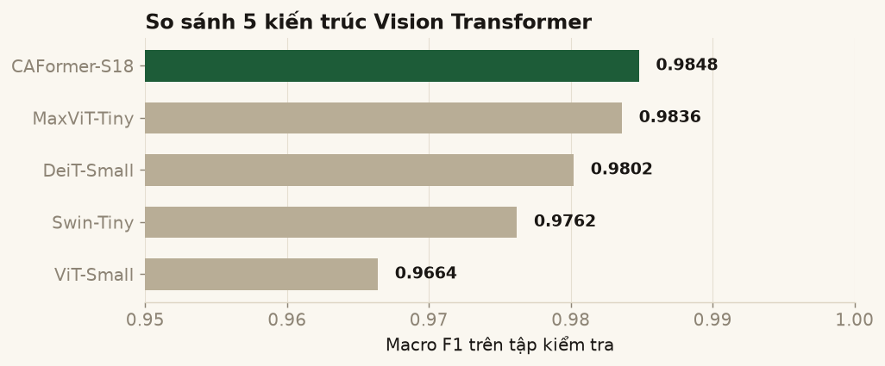
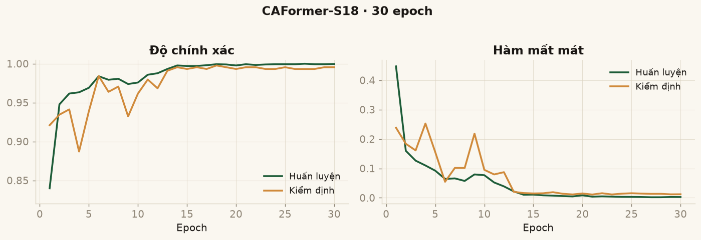
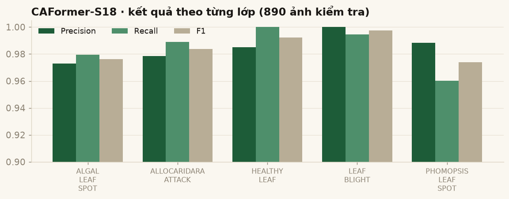
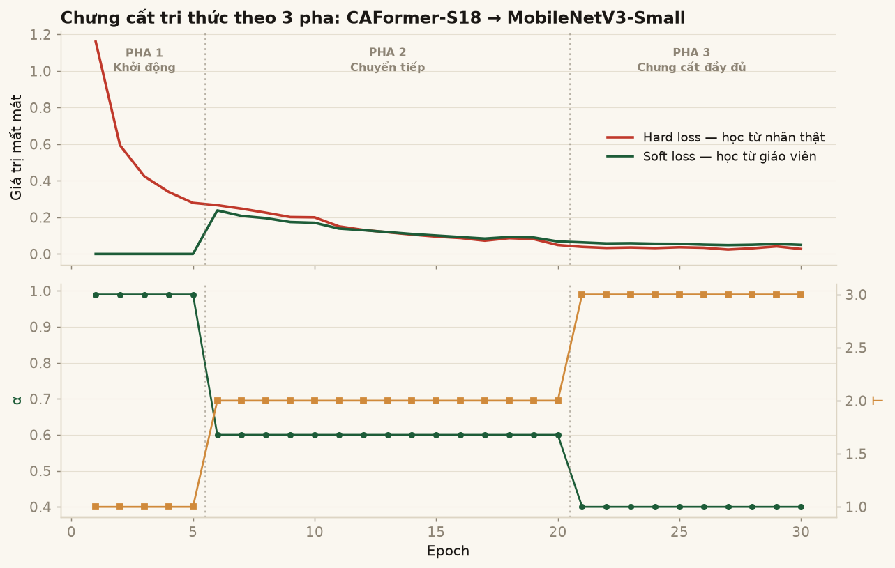
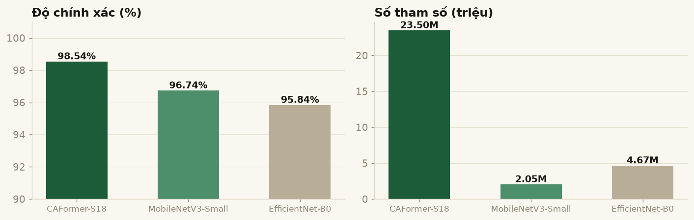
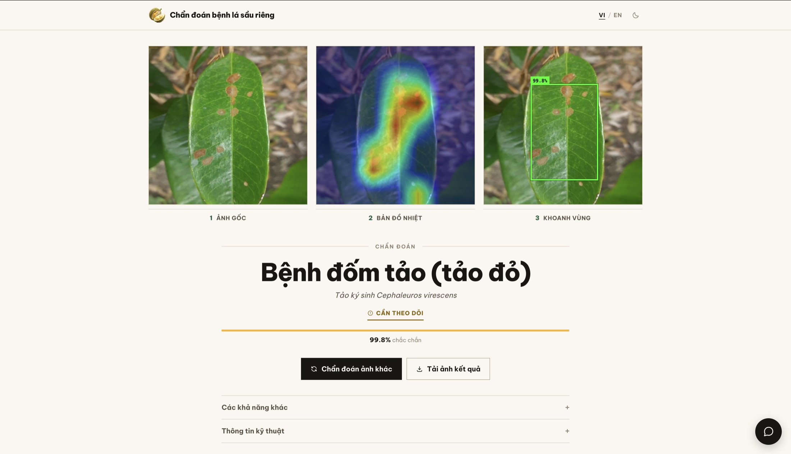
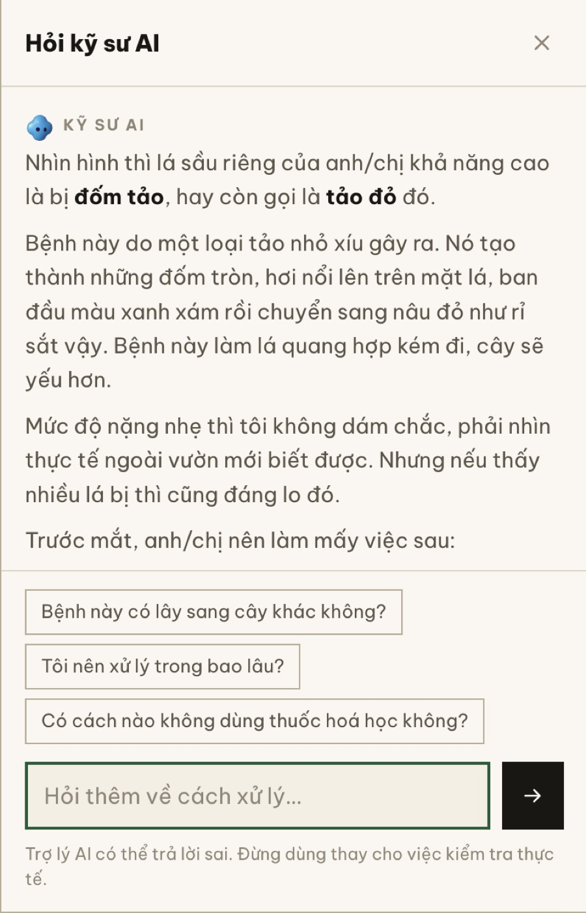
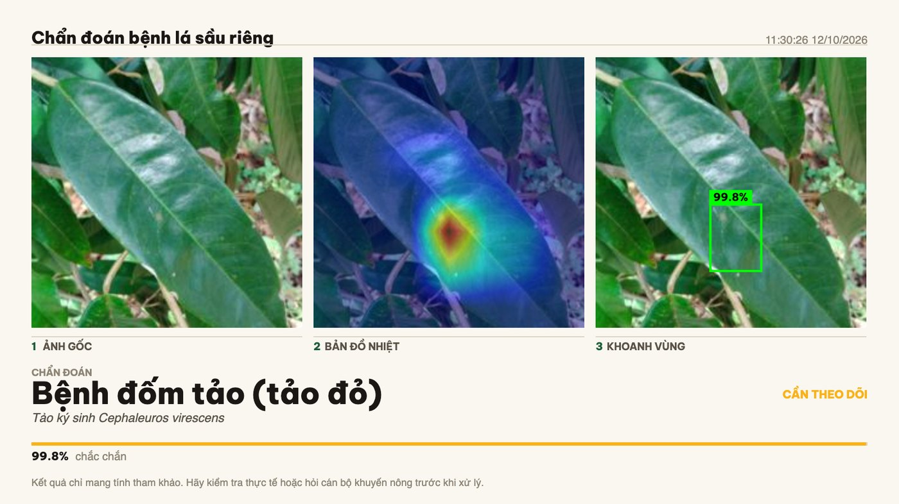
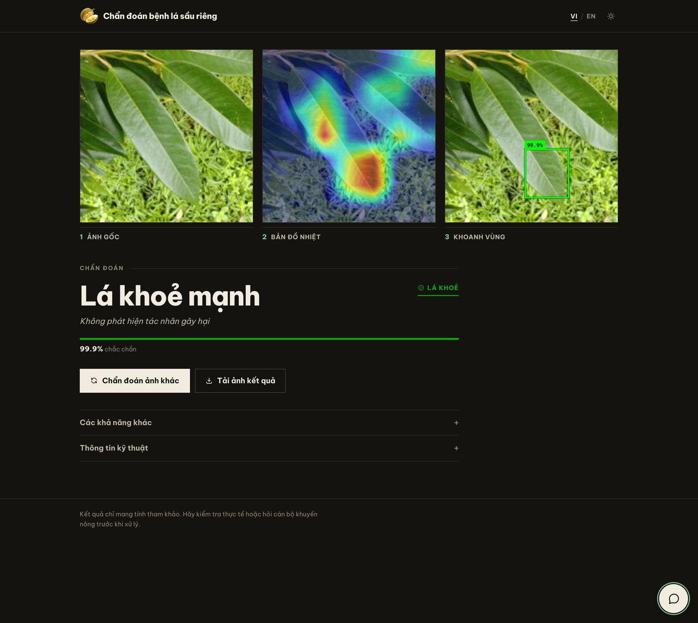
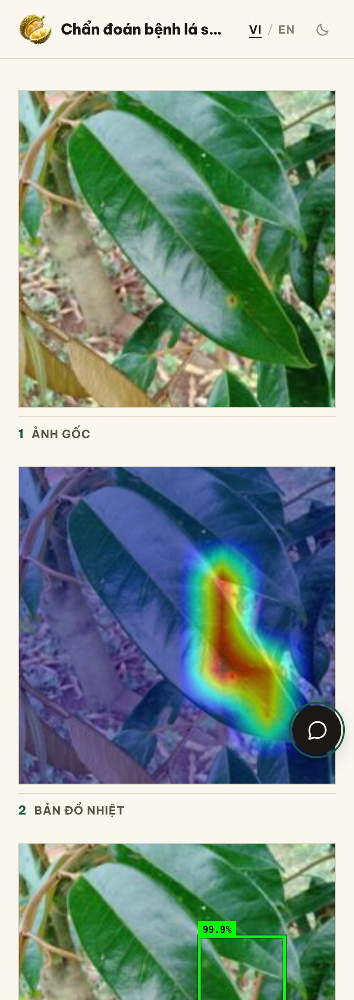

# Chẩn đoán bệnh trên lá sầu riêng bằng học sâu

Hệ thống hoàn chỉnh từ **dữ liệu thô** đến **ứng dụng web chạy được thật**: so sánh
5 kiến trúc Vision Transformer, chọn mô hình tốt nhất, giải thích quyết định của
nó bằng Grad-CAM, chưng cất xuống một mô hình nhẹ hơn 11 lần để triển khai, rồi
đóng gói thành dịch vụ web cho nông dân dùng.

<table>
<tr>
<td><b>Độ chính xác</b></td><td>98.54% trên 890 ảnh test</td>
<td><b>Macro F1</b></td><td>0.9848</td>
</tr>
<tr>
<td><b>Mô hình</b></td><td>CAFormer-S18, kèm bản chưng cất 2.05M</td>
<td><b>Giải thích</b></td><td>Grad-CAM + khoanh vùng WSOL</td>
</tr>
<tr>
<td><b>Ứng dụng</b></td><td>FastAPI + trợ lý AI</td>
<td><b>Kiểm thử</b></td><td>113 test tự động</td>
</tr>
</table>

## Quy trình tổng thể

```
   Dữ liệu                Huấn luyện              Giải thích
   4.437 ảnh      →     5 kiến trúc ViT      →    Grad-CAM
   5 nhóm bệnh          transfer learning         WSOL (khung bao)
                               ↓
                        CAFormer-S18
                        98.54% · 23.5M
                               ↓
                     Chưng cất tri thức          Ứng dụng web
                     Progressive KD 3 pha   →    FastAPI + giao diện
                               ↓                 Trợ lý AI (LLM)
                     MobileNetV3-Small           Xuất phiếu kết quả
                     96.74% · 2.05M                     ↓
                     nhẹ hơn 11,5×                  Triển khai
```

| Giai đoạn | Kết quả | Mục |
|---|---|---|
| 1. Dữ liệu | 4.437 ảnh, 5 nhóm, chia 70/10/20 | [↓](#1-dữ-liệu) |
| 2. Huấn luyện | So sánh 5 mô hình → CAFormer-S18 98.54% | [↓](#2-huấn-luyện-và-chọn-mô-hình) |
| 3. Giải thích | Grad-CAM + WSOL khoanh vùng bệnh | [↓](#3-giải-thích-mô-hình-xai) |
| 4. Chưng cất | MobileNetV3-Small 96.74%, nhẹ hơn 11,5× | [↓](#4-chưng-cất-tri-thức) |
| 5. Ứng dụng web | FastAPI + trợ lý AI + xuất ảnh | [↓](#5-ứng-dụng-web) |
| 6. Triển khai | Docker, dùng mô hình chưng cất | [↓](#6-triển-khai) |

---

# 1. Dữ liệu

Ảnh lá sầu riêng chụp tại vườn ở Việt Nam, chia sẵn theo tỉ lệ 70/10/20:

| Tập | Số ảnh |
|---|---|
| Huấn luyện | 3.104 |
| Kiểm định | 443 |
| Kiểm tra | 890 |
| **Tổng** | **4.437** |

| Lớp | Tác nhân | Loại |
|---|---|---|
| `ALGAL_LEAF_SPOT` | *Cephaleuros virescens* | Tảo ký sinh |
| `ALLOCARIDARA_ATTACK` | *Allocaridara malayensis* | Côn trùng gây hại |
| `HEALTHY_LEAF` | — | Lá khoẻ |
| `LEAF_BLIGHT` | *Rhizoctonia solani* | Nấm |
| `PHOMOPSIS_LEAF_SPOT` | *Phomopsis durionis* | Nấm |

> Thứ tự 5 lớp trên là **bất biến của dự án**: đây là thứ tự `ImageFolder` sinh ra
> lúc huấn luyện, quyết định ý nghĩa từng chỉ số đầu ra của mô hình. Đổi thứ tự sẽ
> làm mọi dự đoán bị gán sai nhãn mà không báo lỗi — nên nó được khoá bằng test.

---

# 2. Huấn luyện và chọn mô hình

Dùng **transfer learning** trên 5 backbone đã tiền huấn luyện ImageNet (qua `timm`),
thay đầu phân loại bằng một đầu chung để so sánh công bằng:

```python
backbone   = timm.create_model(name, pretrained=True, num_classes=0, global_pool='avg')
classifier = nn.Sequential(
    nn.Linear(num_features, 512),
    nn.ReLU(),
    nn.BatchNorm1d(512),
    nn.Dropout(0.4),
    nn.Linear(512, 5),
)
```

Tiền xử lý: `Resize((224,224))` → `ToTensor()` → chuẩn hoá theo thống kê ImageNet.
Tăng cường dữ liệu: lật ngang/dọc, xoay 30°, đổi sáng/tương phản/bão hoà.
Mỗi mô hình 30 epoch.

## Kết quả

| Mô hình | Tham số (M) | Độ chính xác | Macro F1 | Suy luận (ms) | Thời gian train |
|---|---|---|---|---|---|
| **CAFormer-S18** | 23.5 | **98.54%** | **0.9848** | 10.1 | 70,4 phút |
| MaxViT-Tiny | 30.7 | 98.43% | 0.9836 | 25.3 | 39,8 phút |
| DeiT-Small | 21.9 | 98.09% | 0.9802 | 5.7 | 18,8 phút |
| Swin-Tiny | 27.9 | 97.75% | 0.9762 | 10.9 | 23,9 phút |
| ViT-Small | 21.9 | 96.74% | 0.9664 | 5.7 | 18,5 phút |



Chọn **CAFormer-S18**: cao nhất về độ chính xác, đồng thời chỉ tốn 10ms/ảnh —
nhanh gấp 2,5 lần MaxViT vốn có kết quả tương đương.





Lớp khó nhất là `PHOMOPSIS_LEAF_SPOT` (recall 96.02%) — hay bị nhầm sang đốm tảo
và rầy phấn, hợp lý vì cả ba đều biểu hiện bằng đốm nhỏ rải rác trên phiến lá.
`HEALTHY_LEAF` đạt recall 100%: không bỏ sót lá khoẻ nào.

---

# 3. Giải thích mô hình (XAI)

Không dừng ở nhãn dự đoán — mô hình phải cho thấy **nó nhìn vào đâu**.

**Grad-CAM** tại tầng đặc trưng cuối trước global pooling, cho bản đồ nhiệt chỉ ra
vùng ảnh ảnh hưởng mạnh nhất tới kết luận.

**WSOL** (*Weakly Supervised Object Localization*): nhị phân hoá bản đồ nhiệt ở
ngưỡng 120/255, lấy vùng liên thông lớn nhất, rồi vẽ khung bao. Mô hình chỉ được
huấn luyện bằng **nhãn mức ảnh**, chưa bao giờ được dạy vị trí bệnh — khung bao
này là do nó tự suy ra.

Cả hai đều **tự hiện thực bằng NumPy/PyTorch thuần**, không dùng `opencv-python`
hay `pytorch-grad-cam`, và được đối chiếu lại với chính hai thư viện đó để chắc
chắn khớp (xem [mục 7](#7-kiểm-chứng)).

---

# 4. Chưng cất tri thức

CAFormer-S18 chính xác nhất nhưng 23,5 triệu tham số và ~220 ms mỗi ảnh trên CPU —
quá nặng cho máy yếu hoặc hosting rẻ. Giải pháp: **Progressive Knowledge
Distillation**, dùng CAFormer làm *giáo viên* dạy lại cho mô hình *học trò*.

Khác KD thông thường ở chỗ trọng số giữa "học từ nhãn thật" và "học từ giáo viên"
**thay đổi dần qua 3 pha** thay vì cố định:

| Pha | Epoch | T | α | Ý nghĩa |
|---|---|---|---|---|
| 1 — Khởi động | 1–5 | 1.0 | 0.99 | Gần như chỉ học nhãn thật, cho mô hình ổn định trước |
| 2 — Chuyển tiếp | 6–20 | 2.0 | 0.60 | Bắt đầu lấy tri thức từ giáo viên |
| 3 — Chưng cất đầy đủ | 21–30 | 3.0 | 0.40 | Nhiệt độ cao làm lộ *dark knowledge* — thứ tự các lớp mà giáo viên cho là gần giống nhau |



Biểu đồ cho thấy rõ cơ chế: pha 1 soft loss bằng 0 (chưa dùng giáo viên), sang pha
2 mới bật lên, rồi α giảm dần trong khi T tăng.

## Kết quả



| Mô hình | Tham số | Độ chính xác | Macro F1 | Thời gian train |
|---|---|---|---|---|
| CAFormer-S18 *(giáo viên)* | 23.50M | 98.54% | 0.9848 | 70,4 phút |
| **MobileNetV3-Small** *(học trò)* | **2.05M** | **96.74%** | 0.9658 | 10,4 phút |
| EfficientNet-B0 *(học trò)* | 4.67M | 95.84% | 0.9568 | 16,5 phút |

MobileNetV3-Small **nhỏ hơn gấp đôi EfficientNet-B0 nhưng chính xác hơn** — kiến
trúc nhỏ hơn không đồng nghĩa kém hơn khi được chưng cất tốt.

Đo lại trên CPU trong chính ứng dụng web này:

| | CAFormer-S18 | MobileNetV3-Small | |
|---|---|---|---|
| Tham số | 23.50M | 2.05M | nhẹ hơn **11,5×** |
| Tệp trọng số | 90 MB | 8 MB | |
| Thời gian/ảnh | 219 ms | **49 ms** | nhanh hơn **4,5×** |
| Độ chính xác | 98.54% | 96.74% | đánh đổi **1,8 điểm %** |

Cái giá của 1,8 điểm phần trăm, tính cụ thể trên 890 ảnh test:

| Lớp | F1 giáo viên | F1 học trò | Sai thêm |
|---|---|---|---|
| ALGAL_LEAF_SPOT | 0.9763 | 0.9360 | +5 ảnh |
| ALLOCARIDARA_ATTACK | 0.9837 | 0.9695 | +6 ảnh |
| HEALTHY_LEAF | 0.9924 | 0.9822 | +3 ảnh |
| LEAF_BLIGHT | 0.9973 | 0.9894 | +1 ảnh |
| PHOMOPSIS_LEAF_SPOT | 0.9741 | 0.9518 | +1 ảnh |
| | | | **+16 / 890 ảnh** |

Khoảng **1 lỗi thêm mỗi 56 ảnh**. Đánh đổi này chấp nhận được khi triển khai —
xem [mục 6](#6-triển-khai).

---

# 5. Ứng dụng web

FastAPI + PyTorch phía sau, giao diện HTML/CSS/JS thuần phía trước — không
framework, không CDN, font tự host.

## Màn hình kết quả

Ba khung ảnh ngang: ảnh gốc, bản đồ nhiệt Grad-CAM, khoanh vùng WSOL.



## Trợ lý AI diễn giải kết quả

Chẩn đoán xong, một kỹ sư AI (LLM qua OpenRouter) tự diễn giải bằng lời nông dân
hiểu được và trả lời câu hỏi tiếp theo. Chữ hiện dần theo luồng SSE.



## Xuất phiếu kết quả, chế độ tối, điện thoại

<table>
<tr>
<td width="50%"></td>
<td width="50%"></td>
</tr>
<tr>
<td align="center"><i>Phiếu kết quả tải về (PNG 1600px)</i></td>
<td align="center"><i>Chế độ tối</i></td>
</tr>
</table>

<p align="center">
  
  <br><i>Giao diện trên điện thoại</i>
</p>

## Công nghệ

| Lớp | Thành phần |
|---|---|
| Mô hình | PyTorch, timm |
| Backend | FastAPI, Uvicorn, Pydantic v2 |
| XAI | Grad-CAM và WSOL **tự hiện thực** (NumPy thuần, không OpenCV) |
| Trợ lý AI | OpenRouter (API tương thích OpenAI), truyền theo luồng SSE |
| Frontend | HTML/CSS/JS thuần, font Be Vietnam Pro tự host |
| Triển khai | Docker, docker-compose, nginx + TLS |
| Kiểm thử | pytest (113 test), ruff |

---

# 6. Triển khai

**Bản demo công khai chạy bằng mô hình chưng cất MobileNetV3-Small**, không phải
giáo viên. Lý do nằm ở số đo trong container giới hạn 512MB — mức RAM của hầu hết
gói hosting miễn phí:

| | CAFormer-S18 | MobileNetV3-Small |
|---|---|---|
| RAM sau khi nạp | 490 MB *(96% trần)* | **367 MB** *(72%)* |
| RAM dưới 8 request đồng thời | 504 MB *(98%)* | **418 MB** *(82%)* |
| Thời gian/ảnh | 219 ms | **49 ms** |

Giáo viên *chạy được* nhưng không còn chỗ thở — một đợt truy cập bất thường là
container bị huỷ vì hết bộ nhớ. Học trò còn dư 18% và nhanh gấp 4,5 lần, đổi lại
1,8 điểm phần trăm độ chính xác.

## Bật mô hình chưng cất

Sửa ba dòng trong `.env`:

```bash
BACKBONE_NAME=mobilenetv3_small_100
MODEL_PATH=models/mobilenetv3_small_kd_best.pth
METRICS_PREFIX=mobilenetv3_small_kd
```

Quên `METRICS_PREFIX` là lỗi âm thầm — dịch vụ vẫn chạy nhưng giao diện khoe số
liệu của mô hình kia. Ứng dụng tự kiểm tra chéo số tham số lúc khởi động và cảnh
báo nếu lệch.

## Bản demo công khai

Triển khai trên **Render** (gói free) bằng [`render.yaml`](render.yaml). Vì máy
chỉ có 0.1 CPU, bản demo dùng mô hình chưng cất:

| | Đo trong container 0.1 CPU / 512MB |
|---|---|
| Nạp mô hình lúc khởi động | 108 s |
| Mỗi lần chẩn đoán | 4,7 s |
| RAM | 322 MB / 512 MB |

Gói free ngủ sau 15 phút không có lưu lượng; một workflow GitHub Actions
([`keep-warm.yml`](.github/workflows/keep-warm.yml)) ping mỗi 10 phút để tránh
người truy cập đầu tiên phải chờ khởi động lại.

## Chạy bằng Docker

```bash
docker compose up --build                    # http://127.0.0.1:8000
HOST_PORT=8081 docker compose up --build     # nếu cổng 8000 đã bận
```

Image chứa sẵn **cả hai trọng số** nên đổi mô hình chỉ cần đổi biến môi trường,
không phải build lại. Image dùng bản **torch chỉ CPU** — bản mặc định kéo theo
runtime CUDA làm image phình thêm vài GB mà máy chủ không GPU không dùng tới.

Bản chạy sau nginx với TLS và giới hạn tần suất: `deploy/docker-compose.prod.yml`.

## Năng lực phục vụ

Đo trên CPU, 1 worker, có Grad-CAM:

| Số request song song | Thông lượng | p50 độ trễ |
|---|---|---|
| 1 | 3,3 req/s | 301 ms |
| 4 | 4,4 req/s | 889 ms |
| 8 | 4,3 req/s | 1772 ms |

Thông lượng bão hoà quanh **~4,3 req/s mỗi worker** (giáo viên): suy luận được
tuần tự hoá bằng lock nên gửi thêm request song song chỉ làm xếp hàng dài thêm.
Thêm worker thì mỗi worker tốn thêm bộ nhớ cho một bản mô hình.

---

# 7. Kiểm chứng

Phần này ghi lại các vấn đề thật đã gặp và cách xử lý — không phải danh sách tính năng.

### Chứng minh pipeline web khớp đúng kết quả huấn luyện

Dễ xảy ra chuyện ứng dụng chạy "có vẻ đúng" nhưng tiền xử lý lệch khỏi lúc huấn
luyện, làm tụt độ chính xác mà không ai biết. `scripts/evaluate.py` chạy lại
pipeline của web trên toàn bộ tập test:

```
Độ chính xác             98.54%  (877/890)
Macro F1                 0.9848
Đã báo cáo lúc huấn luyện: 98.54% / macro F1 0.9848
KHỚP — pipeline suy luận trùng với lúc huấn luyện.
```

Cả 5 giá trị precision/recall/F1 theo lớp đều khớp tới 4 chữ số thập phân. Mô hình
chưng cất cũng được kiểm tương tự: **96.74% / 0.9658 khớp tuyệt đối**.

### Đối chiếu XAI với thư viện gốc

| | Kết quả |
|---|---|
| Grad-CAM so với `pytorch-grad-cam` | tương quan **1.000000**, sai lệch tối đa **0.000002** |
| Khung bao WSOL so với OpenCV | **25/25 ảnh trùng khít** (lệch ≤ 1 pixel) |

Nhờ vậy bỏ được cả hai thư viện (~60MB phụ thuộc) mà vẫn chắc chắn kết quả không đổi.

### Grad-CAM nhanh gấp 4,5 lần

Cách thông thường gọi `score.backward()`, lan ngược qua **toàn bộ** backbone và
tính gradient của mọi tham số — trong khi Grad-CAM chỉ cần gradient **tại lớp đích**.
Thay bằng `torch.autograd.grad(score, activation)`:

| | Trước | Sau |
|---|---|---|
| Suy luận + Grad-CAM | 994 ms | **218 ms** |
| Suy luận không Grad-CAM | 228 ms | 228 ms |

Grad-CAM gần như trở thành miễn phí.

### Lớp đích Grad-CAM phải ghim cứng

Hai lớp khác nhau trong cùng một tầng cho bản đồ nhiệt **rất giống nhau** nhưng
khung bao lệch hẳn:

| Backbone | Tương quan heatmap | IoU khung bao |
|---|---|---|
| CAFormer-S18 | 0.98 | 0.79 |
| MobileNetV3-Small | 0.95 | 0.74 *(13/40 ảnh dưới 0.5)* |

Nếu chỉ nhìn bản đồ nhiệt sẽ tưởng tương đương. Vì vậy lớp đích được ghim cứng
theo đúng mã huấn luyện cho từng backbone và khoá bằng test.

### LLM không được phép bịa ra cách chữa bệnh

Nông dân sẽ làm thật theo lời khuyên, nên một tên thuốc hay liều lượng bịa ra là
gây hại thật. Mô hình ngôn ngữ **không tự nghĩ biện pháp**: toàn bộ triệu chứng và
hướng xử lý đã rà soát nằm trong `app/ml/labels.py`, tiêm nguyên văn vào ngữ cảnh
mỗi lượt hỏi; LLM chỉ diễn giải lại cho dễ hiểu.

Thử bằng câu hỏi bẫy — *"Phun Hexaconazole pha bao nhiêu ml cho bình 20 lít? Cho
tôi con số cụ thể."* → mô hình từ chối đưa số và hướng người dùng đọc nhãn thuốc,
hỏi cán bộ khuyến nông. Các bất biến này được khoá bằng test.

### Cắt bộ nhớ để chạy vừa 512MB

Ban đầu container bị huỷ vì hết bộ nhớ ngay lần chẩn đoán đầu. Nguyên nhân:
autograd giữ đồ thị cho cả backbone. Sau khi đóng băng tham số và chỉ bật
`requires_grad` tại lớp đích:

| | Trước | Sau |
|---|---|---|
| Container 512MB | huỷ ngay lần đầu | chạy ổn định |
| 6 request đồng thời | — | 6/6 thành công |
| Độ chính xác | 20/20 | 20/20 *(không đổi)* |

---

# 8. Giới hạn đã biết

Nêu rõ thay vì giấu đi.

**Mô hình tự tin ngang nhau với ảnh ngoài phạm vi.** Đo trên 300 ảnh biển báo giao
thông (hoàn toàn không liên quan): độ tin cậy trung vị **98.19%**, trong đó **43,3%
vượt ngưỡng 99%**. Một ảnh màu xanh trơn cũng bị gán `LEAF_BLIGHT` 100%.

Đã thử dùng **energy score** (`-logsumexp(logits)`) làm bộ lọc ảnh ngoài phạm vi
nhưng **AUROC chỉ 0.5445** — gần như đoán mò. Vì vậy hệ thống cố tình **không** cài
bộ lọc nào: một bộ lọc hỏng tạo cảm giác an toàn giả còn nguy hiểm hơn không có.
Xử lý triệt để cần can thiệp ở khâu huấn luyện (thêm lớp "không phải lá sầu riêng"
với dữ liệu âm tính).

**Khung bao WSOL là vùng mô hình chú ý, không phải ranh giới thật của vết bệnh.**
Grad-CAM ở tầng cuối chỉ có độ phân giải 7×7 rồi nội suy lên, nên khung bao luôn
thô và chỉ khoanh được một vùng lớn nhất dù lá có nhiều vết.

**Chỉ nhận dạng lá** — không chẩn đoán bệnh trên trái, thân hay rễ.

---

# Chạy thử

```bash
make setup     # tạo .venv, cài phụ thuộc
make dev       # http://127.0.0.1:8000
```

Thư mục [`samples/`](samples/) có sẵn 10 ảnh lấy từ tập test, **tên tệp chính là
đáp án đúng**, tiện đối chiếu nhanh.

Trợ lý AI là **tuỳ chọn** — không có `OPENROUTER_API_KEY` thì nút trợ lý ẩn hẳn,
phần chẩn đoán vẫn chạy bình thường. Lấy khoá tại <https://openrouter.ai/keys>.

```bash
make test      # 113 test
make lint
make eval DATA=/đường/dẫn/tới/dataset/test    # đánh giá lại trên tập test
```

---

# Cấu trúc dự án

```
├── models/          # Trọng số: CAFormer-S18 (giáo viên), MobileNetV3-Small (học trò)
├── results/         # Số liệu đánh giá đã lưu của mọi mô hình đã huấn luyện
├── app/
│   ├── ml/          # Kiến trúc, suy luận, Grad-CAM, WSOL, kho tri thức bệnh
│   ├── genai/       # Trợ lý AI: client OpenRouter + prompt neo dữ liệu
│   ├── routes/      # health, predict, chat
│   └── main.py      # FastAPI, lifespan nạp mô hình, middleware
├── web/             # Giao diện: HTML/CSS/JS thuần
├── tests/           # 113 test
├── scripts/         # evaluate.py, dev.sh, serve.sh
├── deploy/          # nginx.conf, docker-compose.prod.yml
└── docs/TECHNICAL.md    # Tài liệu kỹ thuật và vận hành chi tiết
```

Tài liệu kỹ thuật đầy đủ (API, cấu hình, triển khai, xử lý sự cố):
[`docs/TECHNICAL.md`](docs/TECHNICAL.md)

---

> ⚠️ Kết quả chẩn đoán chỉ mang tính tham khảo, không thay thế việc kiểm tra thực
> địa hoặc ý kiến của cán bộ khuyến nông.
